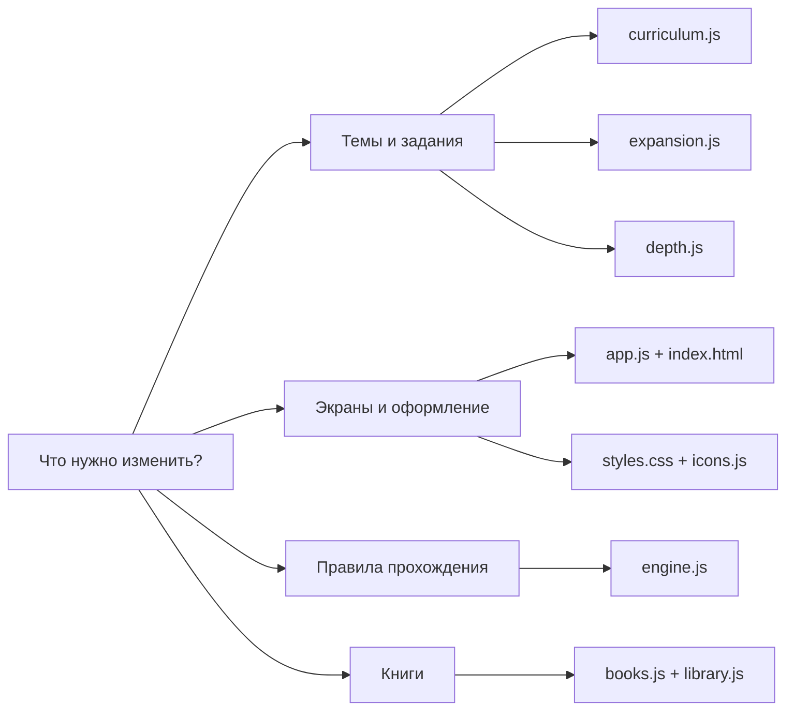
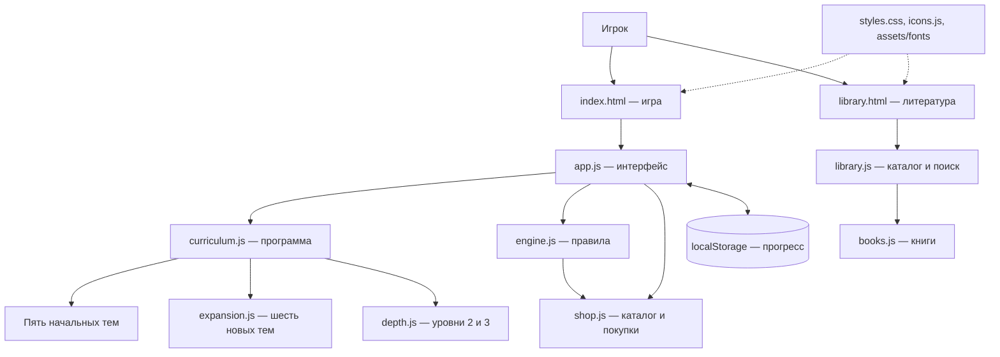
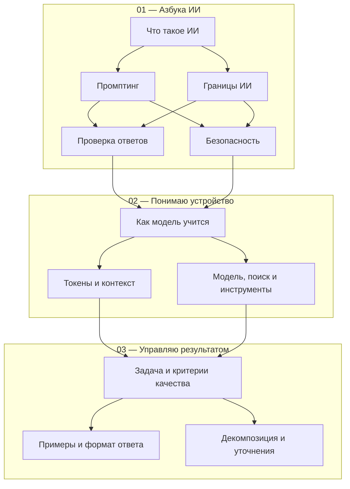
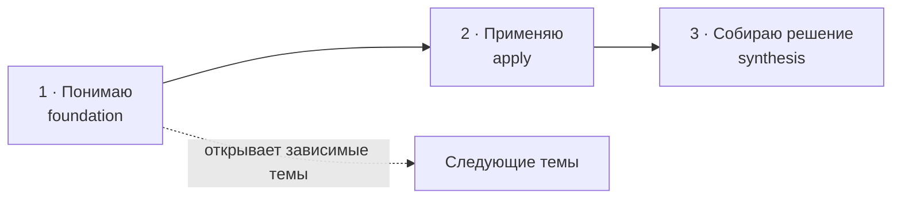
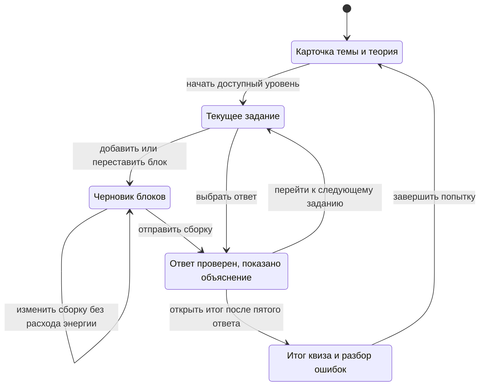
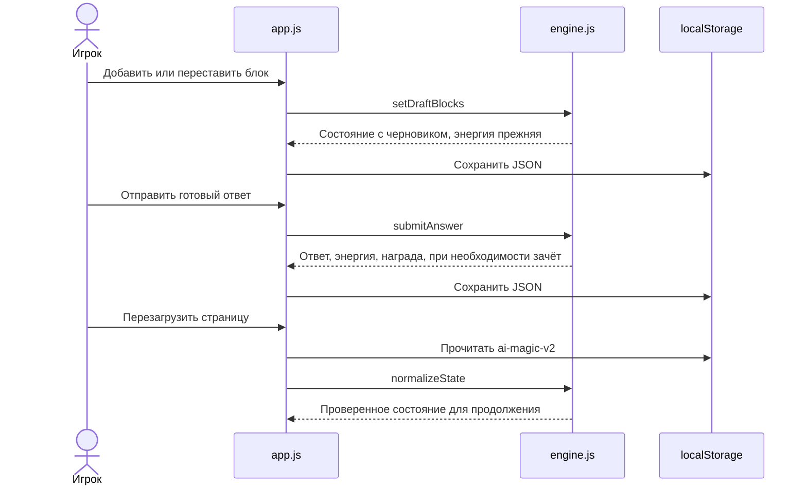
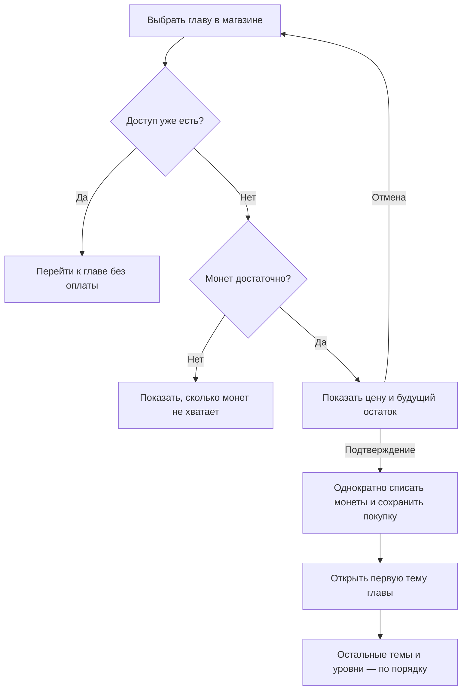
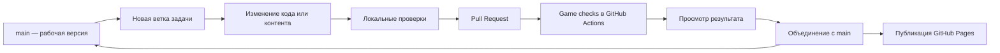
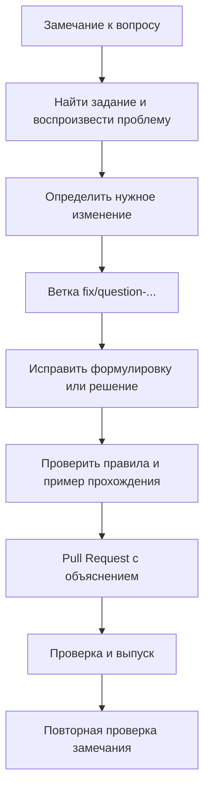
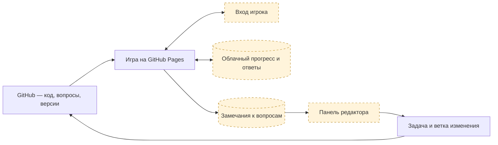

# ✳ AI Magic

**Игра для изучения искусственного интеллекта: от первого запроса до самостоятельной работы.**

Игрок раскрывает главы, выбирает тему, читает теорию и проходит короткие квизы. У каждой темы три уровня: **понимаю → применяю → собираю решение**. В заданиях нужно выбрать ответ или составить правильную последовательность из блоков.

🌐 **[Открыть игру](https://khokhlovartem.github.io/AI-Magic/)** · 📚 **[Литература](https://khokhlovartem.github.io/AI-Magic/library.html)** · 💬 **[Предложить доработку вопроса](https://github.com/KhokhlovArtem/AI-Magic/issues/new/choose)**

| Что есть сейчас | Объём |
| --- | --- |
| Раскрывающиеся главы | 3 |
| Учебные темы | 11 |
| Уровни понимания | 33 |
| Задания | 183 |
| В том числе сборка из блоков | 55 |
| Книги в литературе | 10 |

## 🧭 Как читать этот репозиторий



**Быстрые ориентиры:**

- Добавить новую тему — начать с `curriculum.js` и `expansion.js`.
- Изменить задания уровней 2–3 — открыть `depth.js`.
- Изменить оценку ответа, энергию или зачёт — открыть `engine.js`.
- Изменить вид квиза или сборки — открыть `app.js` и `styles.css`.
- Добавить книгу — открыть `books.js`.
- Проверить изменение — выполнить `npm run check` и `npm test`.

## 📁 Карта каталогов и файлов

Сайт публикуется прямо из корня репозитория. Файлы приложения одновременно являются готовой версией для браузера: отдельного этапа сборки нет.

```text
AI-Magic/
│
├── index.html                 🎮 Главная страница и контейнеры игры
├── app.js                     🖱️ Экраны, действия игрока, главы и квизы
├── engine.js                  ⚙️ Правила, проверка ответов, прогресс
├── shop.js                    🛍️ Каталог, цены и сохранённые покупки
│
├── curriculum.js              🗺️ Главы, первые пять тем, общая программа
├── expansion.js               🌱 Следующие шесть тем и начальные вопросы
├── depth.js                   🧩 Задания уровней 2 и 3 для всех тем
│
├── library.html               📚 Страница литературы
├── library.js                 🔎 Поиск, фильтры и карточки книг
├── books.js                   📖 Данные десяти книг и трёх категорий
│
├── styles.css                 🎨 Общие стили игры, квизов и библиотеки
├── icons.js                   ✳️ Набор встроенных SVG-иконок
├── assets/
│   └── fonts/
│       ├── Manrope-Variable.ttf 🔤 Локальный шрифт
│       └── OFL.txt             📜 Лицензия шрифта
│
├── scripts/
│   ├── serve.mjs              🖥️ Локальный HTTP-сервер для разработки
│   └── check-site.mjs          🔗 Проверка синтаксиса и локальных файлов
├── tests/
│   ├── engine.test.mjs         🧪 Проверки движка и учебного контента
│   └── shop.test.mjs           🪙 Проверки покупок и доступа к главам
│
├── .github/
│   ├── workflows/
│   │   └── checks.yml         ✅ Автоматические проверки изменений
│   ├── ISSUE_TEMPLATE/
│   │   └── question-review.yml 💬 Форма замечания к вопросу
│   └── pull_request_template.md 📝 Шаблон описания изменения
│
├── package.json               ▶️ Команды разработки и версия среды
├── .node-version              🟢 Node.js 22 для автоматических проверок
├── .gitignore                 🧹 Локальные файлы, не входящие в Git
├── .nojekyll                  🌐 Публикация готовых файлов GitHub Pages
└── README.md                  🧭 Эта карта проекта
```

### 🎮 Главная страница и интерфейс

| Файл | Ответственность | Когда открывать |
| --- | --- | --- |
| `index.html` | Шапка, навигация, контейнер глав, статистика, модальное окно | Для изменения общей структуры страницы |
| `app.js` | Чтение сохранения, вывод глав и тем, выбор уровня, прохождение квиза, работа с блоками, разбор результата | Для изменения пользовательского сценария |
| `styles.css` | Цвета, сетки, мобильный вид, раскрывающиеся главы, карточки уровней и книг | Для изменения оформления |
| `icons.js` | Функция `icon()` и SVG-значки тем | Для добавления или замены значков |

Главы используют стандартные элементы `<details>` и `<summary>`. Несколько глав можно раскрыть одновременно. Порядок блоков меняется кнопками, поэтому задания доступны с клавиатуры и на телефоне без перетаскивания.

### ⚙️ Движок и учебные данные

| Файл | Что хранит или делает |
| --- | --- |
| `engine.js` | Создаёт состояние игры; проверяет зависимости и уровни; запускает квиз; оценивает оба типа ответа; начисляет награды; хранит черновик блоков; переносит старые сохранения |
| `shop.js` | Хранит каталог товаров с постоянными ID и ценами, определяет купленный доступ, проверяет записи о покупках при чтении сохранения |
| `curriculum.js` | Описывает три главы, пять начальных тем и собирает итоговый массив `curriculum` |
| `expansion.js` | Добавляет шесть тем об устройстве моделей и управлении результатом; содержит уроки, источники и начальные вопросы |
| `depth.js` | Создаёт отдельные наборы заданий для уровней `apply` и `synthesis`; содержит помощники для выбора ответа и сборки блоков |

### 📚 Литература и локальные ресурсы

`library.html` задаёт структуру библиотеки, `library.js` выводит карточки и обрабатывает поиск, а `books.js` содержит сами записи. В книге указаны категория, название, автор, рекомендуемый этап чтения, описание и официальная ссылка.

Шрифт Manrope находится в `assets/fonts/` и загружается с того же сайта. Для работы интерфейса не требуется Google Fonts. Полные тексты книг не хранятся в репозитории — библиотека содержит описания и ссылки.

## 🏗️ Как части приложения связаны



Движок не обращается к странице и не выполняет сетевые запросы. Он принимает состояние и данные, а возвращает новое состояние. Это позволяет проверять правила без браузера. Интерфейс вызывает движок и сохраняет результат в браузере.

## 🌳 Учебный маршрут

Стрелка означает: для открытия следующей темы нужен хотя бы **первый уровень** предыдущей. Когда к теме ведут две стрелки, нужны обе зависимости.



Внутри каждой темы действует отдельная последовательность:



Первый уровень проверяет основные понятия. Второй добавляет применение к ситуациям. Третий требует собрать целостный процесс, учитывая порядок шагов и лишние действия.

## 🧩 Как устроены задания

### Выбор одного ответа

```js
{
  id: 'example-choice-1',
  text: 'Что нужно проверить перед использованием ответа?',
  options: ['Факты и соответствие цели', 'Только длину', 'Только оформление'],
  correct: 0,
  explanation: 'Полезность ответа определяется задачей и достоверностью фактов.'
}
```

`correct` — индекс правильного варианта в исходном массиве, начиная с нуля. При показе варианты перемешиваются; сохраняется именно исходный индекс выбранного варианта.

### Сборка ответа из блоков

```js
{
  id: 'example-blocks-1',
  type: 'blocks',
  text: 'Собери цикл работы: план, ревью, исполнение, проверка, следующая итерация.',
  blocks: [
    { id: 'plan', text: 'Формирование плана' },
    { id: 'review', text: 'Ревью плана' },
    { id: 'execute', text: 'Исполнение' },
    { id: 'check', text: 'Проверка и уточнение' },
    { id: 'next', text: 'Следующая итерация' },
    { id: 'skip', text: 'Пропустить проверку' }
  ],
  correctOrder: ['plan', 'review', 'execute', 'check', 'next'],
  explanation: 'Следующая итерация опирается на результат проверки.'
}
```

Важны и состав, и порядок. Блоки, отсутствующие в `correctOrder`, являются лишними. Изменение черновика не расходует энергию; проверка выполняется только после отправки сборки.

### Правила изменения контента

1. Сохраняйте опубликованные `id` тем, уровней и заданий: к ним привязаны зачёты, награды и попытки.
2. Новый вопрос должен иметь уникальный `id`, объяснение и однозначно заданное решение.
3. На уровне должно быть не меньше пяти заданий. Квиз выбирает пять; набор и варианты перемешиваются.
4. В `depth.js` идентификаторы заданий пока зависят от их позиции в наборе. Дополняйте набор в конце и не переставляйте опубликованные задания.
5. Изменения смысла, эталона, состава или исходного порядка вариантов требуют проверки влияния на сохранённые попытки. История версий вопросов — один из следующих этапов.
6. После расширения обновите ожидаемые объёмы программы в тестах и README, затем выполните проверки.

## 🔄 Прохождение квиза



Это схема пользовательского сценария. В сохранении `active.phase` используются два значения: `question` и `result`. Экран теории не является отдельной фазой сохранённого квиза.

| Правило | Текущее поведение |
| --- | --- |
| Длина квиза | 5 заданий |
| Зачёт уровня | Не менее 4 верных решений |
| Энергия | 1 за отправленный ответ; для старта нужно 5 |
| Восстановление | До 60 через 8 часов после первого потраченного балла |
| Черновик блоков | Можно менять бесплатно |
| Повторная отправка одного ответа | Не списывает энергию и не даёт награду второй раз |
| Награда | 1 монета и 10 XP за первый правильный ответ на задание |
| Повторный квиз | Не отменяет прежний зачёт и не повышает уровень повторно |

Зачёт фиксируется вместе с пятым ответом, ещё до открытия итогового экрана. Закрытие окна в этот момент не должно приводить к потере результата.

## 💾 Сохранение прогресса



Основной ключ — `ai-magic-v2`. Старый `ai-magic-v1` переносится при первом чтении.

| Поле состояния | Назначение |
| --- | --- |
| `version` | Версия формата сохранения |
| `progress` | Зачёты, лучший и последний результат, число попыток по теме и уровню |
| `rewards` | Идентификаторы заданий, награда за которые уже получена |
| `purchases` | Покупки: ID товара, фактически списанная цена и время покупки |
| `energy`, `refillAt` | Текущий запас и момент восстановления |
| `coins`, `xp` | Накопленные награды |
| `answered`, `correct` | Общая статистика ответов |
| `active` | Текущая тема, уровень, порядок заданий и вариантов, отправленные ответы и черновики |
| `history` | Итоги последних 30 завершённых квизов |

**Сейчас сохранение локальное:** оно относится к браузеру и адресу сайта. Аккаунтов и облачной синхронизации пока нет. Постоянный журнал всех отдельных ответов также ещё не реализован: после завершения квиза хранится его итог, а не полный архив решений.

## 🛍️ Магазин и досрочный доступ

Магазин открывается из навигации, через баланс монет и из закрытой главы. Покупка даёт **вход в главу**, а зависимости между её темами и уровнями остаются прежними. Обычное открытие через обучение сохраняется.

| Товар | ID | Глава | Цена |
| --- | --- | --- | --- |
| Досрочный доступ к «Понимаю устройство» | `chapter-models` | `models` · 02 | 200 монет |
| Досрочный доступ к «Управляю результатом» | `chapter-results` | `results` · 03 | 300 монет |



Цены задаются в `shop.js`. Награда остаётся **1 монета** за первый правильный ответ на задание; текущий банк даёт максимум 183 монеты. Поэтому цены 200 и 300 заложены для будущего расширения программы. Бесплатный маршрут позволяет пройти все главы уже сейчас.

`purchaseChapter()` в `engine.js` проверяет доступ и баланс перед списанием. Повторная покупка или попытка купить уже открытую обучением главу не списывает монеты. Покупка не начисляет зачёты и не меняет энергию, XP, ответы или текущий квиз. Подтверждение читает последнее сохранение; в браузерах с Web Locks покупки между вкладками выполняются последовательно.

Запись покупки содержит `itemId`, `price` и `purchasedAt`. Сохраняется фактическая цена, поэтому будущая смена цены не переписывает историю. ID опубликованного товара менять нельзя. Старые сохранения `ai-magic-v2` без `purchases` получают пустой список, сохраняя балансы и достижения. Общий сброс прогресса удаляет и покупки.

Это магазин за игровые монеты с локальным сохранением. При подключении аккаунтов проверку баланса и списание потребуется перенести на сервер, а записи покупок — в общий профиль игрока.

## ▶️ Запуск и проверки

Для разработки нужен **Node.js 22 или новее**. Внешних пакетов сейчас нет, поэтому устанавливать зависимости не требуется.

```sh
git clone https://github.com/KhokhlovArtem/AI-Magic.git
cd AI-Magic
npm run dev
```

Откройте `http://127.0.0.1:4173/`. Для другого порта:

```sh
npm run dev -- 4174
```

Проверки перед предложением изменения:

```sh
npm run check
npm test
```

`check` проверяет синтаксис JavaScript, локальные импорты, файлы обеих страниц, шрифт и наличие `.nojekyll`. `test` запускает 33 проверки правил, данных и совместимости сохранений, включая достижимость всех 33 уровней, работу черновиков блоков, списание монет и покупки.

Открывать `index.html` двойным щелчком вместо HTTP-сервера не следует: приложение использует JavaScript-модули.

## 🌿 Ветки и выпуск изменений



| Пример ветки | Для чего |
| --- | --- |
| `feature/topic-data` | Новая учебная тема |
| `feature/test-format` | Новый способ ответа |
| `fix/question-context-3` | Исправление конкретного задания |
| `chore/development-workflow` | Инструменты и правила разработки |

Перед новой задачей обновите `main`, создайте ветку, выполните изменение и откройте Pull Request. Автоматическая проверка называется **Game checks**. Она запускается для Pull Request в `main`, после изменений `main` и вручную из Actions после появления workflow в основной ветке.

Текущая публикация настроена как **GitHub Pages → main → /(root)**. Этот workflow выполняет проверки; саму публикацию продолжает выполнять действующая настройка Pages. Проверки PR сами по себе не запрещают объединение: обязательность нужно отдельно настроить правилом защиты `main`, выбрав `Game checks`.

Архивы для другого хостинга следует делать из выбранной проверенной версии репозитория. Ручное редактирование нескольких независимых копий усложняет перенос исправлений.

## 💬 Как предложить исправление вопроса

У репозитория есть форма **«Доработка вопроса»** в [GitHub Issues](https://github.com/KhokhlovArtem/AI-Magic/issues/new/choose). Укажите тему, уровень, текст вопроса, причину замечания и при необходимости свой ответ или предлагаемую формулировку.

Это доступный сейчас канал для замечаний. Кнопка внутри задания и общая панель редактора относятся к следующему этапу разработки.



## 🚧 Следующий этап: кабинеты, история ответов и замечания

Схема ниже **планируемая**. Её компонентов пока нет в рабочем приложении.



Предлагаемая основа — Supabase Auth и база данных с разграничением доступа. Игрок видит своё сохранение, редактор — очередь замечаний. Для реализации нужно согласовать и подключить отдельный проект сервиса.

Работы по порядку:

1. **Версии заданий:** постоянный `question_id`, номер версии, фиксация версий при старте квиза.
2. **Аккаунты и перенос сохранения:** вход, облачный прогресс, обработка конфликта с уже существующим сохранением.
3. **Журнал ответов:** выбранный вариант или порядок блоков, версия задания, результат и идентификатор попытки.
4. **Замечание из квиза:** причина, комментарий, предлагаемая формулировка и автоматически приложенный контекст.
5. **Панель редактора:** фильтры, частые ошибки и состояния «новое → в работе → исправлено → проверено».

## 🛣️ Развитие учебной программы

| Этап | Темы | Состояние |
| --- | --- | --- |
| Азбука ИИ | Основы, промптинг, ограничения, проверка, безопасность | 5 тем реализованы |
| Понимаю устройство | Обучение модели, контекст, инструменты | 3 темы реализованы |
| Управляю результатом | Цели, примеры, декомпозиция и уточнения | 3 темы реализованы |
| Работаю с информацией | Тексты, документы, исследование источников | Запланировано |
| Работаю с данными | Таблицы, расчёты, графики | Запланировано |
| Оцениваю качество | Тестирование ответов, неопределённость, вредные инструкции | Запланировано |
| Собираю рабочий процесс | Последовательности, автоматизация, агенты | Запланировано |
| Итоговая миссия | Собственный проверенный процесс с ИИ | Запланировано |

Полный принятый маршрут включает 24 темы, включая итоговую миссию. Самостоятельные свободные работы потребуют отдельного способа оценки; текущий движок проверяет выбор ответа и точную сборку блоков.

## 📎 Полезные ссылки

- [Публикация из ветки в GitHub Pages](https://docs.github.com/en/pages/getting-started-with-github-pages/configuring-a-publishing-source-for-your-github-pages-site).
- [Mermaid-схемы в Markdown на GitHub](https://docs.github.com/en/get-started/writing-on-github/working-with-advanced-formatting/creating-diagrams).
- [JavaScript-модули](https://developer.mozilla.org/en-US/docs/Web/JavaScript/Guide/Modules).
- [Хранилище localStorage](https://developer.mozilla.org/en-US/docs/Web/API/Window/localStorage).

Лицензия шрифта Manrope сохранена в [`assets/fonts/OFL.txt`](assets/fonts/OFL.txt).
